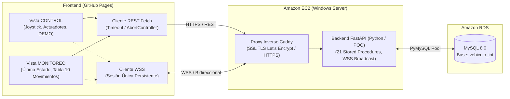

# Plataforma Web de Control y Monitoreo IoT · Excavadora (Mobile First)

Aplicación web integral, modular, reactiva y responsiva desarrollada para el **Control Operativo** y **Monitoreo en Tiempo Real** de un vehículo robótico IoT (Excavadora), consumiendo servicios REST y WebSockets seguros (WSS) desplegados en **Amazon EC2** y persistidos en **Amazon RDS for MySQL**.

---

## 1. Arquitectura del Sistema



---

## 2. Estructura del Proyecto

```plaintext
vehiculo-iot-control/
├── .gitignore
├── favicon.svg              # Icono vectorial para navegador y PWA
├── index.html               # Vistas semánticas accesibles (Control y Monitoreo)
├── README.md                # Documentación técnica completa y casos de prueba
├── monitor.py               # Monitor de consola en tiempo real vía WebSocket
├── css/
│   └── styles.css           # Tema oscuro industrial, joystick polar y tabla responsiva
└── js/
    ├── app.js               # Orquestador del ciclo de vida y eventos globales
    ├── config.js            # Configuración centralizada de endpoints y tiempos
    ├── api/
    │   ├── apiClient.js     # Cliente Fetch con AbortController y manejo de errores
    │   └── vehicleService.js# Consumo de endpoints reales del vehículo
    ├── components/
    │   ├── actionButtons.js # Botones de actuadores (Brazo y Pala)
    │   ├── demoController.js# Control de secuencias autónomas DEMO
    │   ├── joystick.js      # Joystick virtual táctil (Pointer Events)
    │   ├── monitoringView.js# Vista de Monitoreo: Tarjeta de estado y tabla de 10 registros
    │   ├── navigation.js    # Gestor de pestañas accesibles (Control / Monitoreo)
    │   └── statusPanel.js   # Panel de 3 indicadores (WSS, Servidor AWS, Base RDS)
    ├── utils/
    │   └── dateFormatter.js # Formateo seguro y localizado de fechas y horas
    └── ws/
        └── wsClient.js      # Cliente WebSocket seguro con reconexión automática
```

---

## 3. Contratos de la API REST y WebSocket

| Método | Endpoint | Descripción | Stored Procedure |
| :--- | :--- | :--- | :--- |
| `GET` | `/` | Diagnóstico de salud de la API | N/A |
| `GET` | `/vehiculos/1/estado` | Último estado persistido | `sp_obtener_estado` |
| `GET` | `/vehiculos/1/historial` | Últimos 10 movimientos individuales | `sp_obtener_historial` |
| `GET` | `/vehiculos/1/comandos` | Catálogo de comandos del vehículo | `sp_obtener_comandos_vehiculo` |
| `POST`| `/vehiculos/1/movimiento`| Registro atómico de movimiento individual | `sp_actualizar_estado` + `sp_registrar_historial` |
| `GET` | `/vehiculos/1/demos` | Catálogo de rutinas DEMO | `sp_obtener_demos` |
| `POST`| `/vehiculos/1/demos/{id}/iniciar` | Iniciar rutina DEMO en segundo plano | `sp_obtener_movimientos_demo` |
| `POST`| `/vehiculos/1/demos/cancelar` | Cancelar DEMO en curso | En memoria |
| `WSS` | `/ws/vehiculos/1` | Canal de eventos en vivo | N/A |

### Reglas de Negocio Clave
1. **Historial Acotado:** `GET /vehiculos/1/historial` limita a un máximo de 10 registros para optimizar memoria y rendimiento.
2. **Aislamiento de DEMO:** Los pasos de una rutina DEMO actualizan el estado visual en tiempo real vía WebSocket, pero **no** se insertan en la tabla `historial_comandos`, protegiendo la trazabilidad de operaciones manuales.
3. **Prioridad de Detener:** Cualquier pérdida de puntero táctil en el joystick solicita `DETENER` inmediatamente.

---

## 4. Guía de Ejecución Local

1. Clona el repositorio:
   ```bash
   git clone https://github.com/Ema1808/vehiculo-iot-control.git
   cd vehiculo-iot-control
   ```
2. Levanta un servidor local:
   ```bash
   python -m http.server 3000
   ```
3. Abre tu navegador en: `http://localhost:3000`

---

## 5. Publicación en GitHub Pages

1. Sube tu código en la rama `main`:
   ```bash
   git add .
   git commit -m "feat: modulo de monitoreo en tiempo real con historial de 10 registros"
   git push origin main
   ```
2. En GitHub: **Settings** ➔ **Pages** ➔ **Source: Deploy from a branch** ➔ Rama **`main`** ➔ Carpeta **`/ (root)`**.
3. Acceso público HTTPS: `https://ema1808.github.io/vehiculo-iot-control/`

---

## 6. Casos de Prueba Verificables

| # | Caso de Prueba | Procedimiento | Resultado Esperado |
| :--- | :--- | :--- | :--- |
| **CP01** | Carga Inicial y Diagnósticos | Abrir el sitio | Los 3 indicadores pasan a verde (`En línea`, `Disponible`, `Disponible`). Se cargan comandos y catálogo DEMO. |
| **CP02** | Navegación entre Vistas | Clic en pestaña *Monitoreo* | La vista cambia suavemente sin recargar; se consulta REST y se renderiza la tarjeta de estado y la tabla. |
| **CP03** | Envío de Movimiento Individual | Clic en *Subir Brazo* en pestaña *Control* | Envía `POST /movimiento`, status pasa a `OK` y se emite evento WSS. |
| **CP04** | Telemetría en Segunda Pestaña | Abrir dos pestañas (una en Control y otra en Monitoreo) | Al mover el joystick en la primera pestaña, la tarjeta y tabla de la segunda pestaña se actualizan en <100ms. |
| **CP05** | Límite Estricto de 10 Registros | Ejecutar más de 10 movimientos consecutivos | La tabla muestra estrictamente 10 filas (#1 al #10), ordenadas descendentemente por fecha/hora. |
| **CP06** | Formato de Fecha y Hora | Revisar columna *Fecha y Hora* | Se muestra hora local legible `DD/MM/AAAA HH:mm:ss` sin valores `null` o `undefined`. |
| **CP07** | Aislamiento de DEMO | Iniciar una DEMO desde *Control* y observar *Monitoreo* | La tarjeta muestra los pasos de DEMO en tiempo real; la tabla de historial **no** se contamina con pasos de DEMO. |
| **CP08** | Parada de Emergencia | Presionar botón rojo `DETENER` | Cancela DEMO activa, envía comando 9 y tarjeta de monitoreo cambia inmediatamente a rojo `DETENER`. |
| **CP09** | Recuperación ante Reconexión | Desconectar Wi-Fi por 5s y reconectar | WSS pasa a amarillo `Reconectando` y luego a verde `En línea`, resincronizando automáticamente la tabla con REST. |
| **CP10** | Validación Externa WSS | Conectar Thunder Client a `wss://.../ws/vehiculos/1` | Se recibe la trama JSON `MOVIMIENTO_INDIVIDUAL` en tiempo real simultáneamente con el navegador. |

---

## 7. Créditos y Autoría

* **Estudiante:** Emanuel González Mayorga
* **Año:** 2026
* **Institución:** Instituto Tecnológico de Pachuca · TecNM
* **Especialidad:** Internet de las Cosas (IoT) · Arquitectura Cloud AWS
