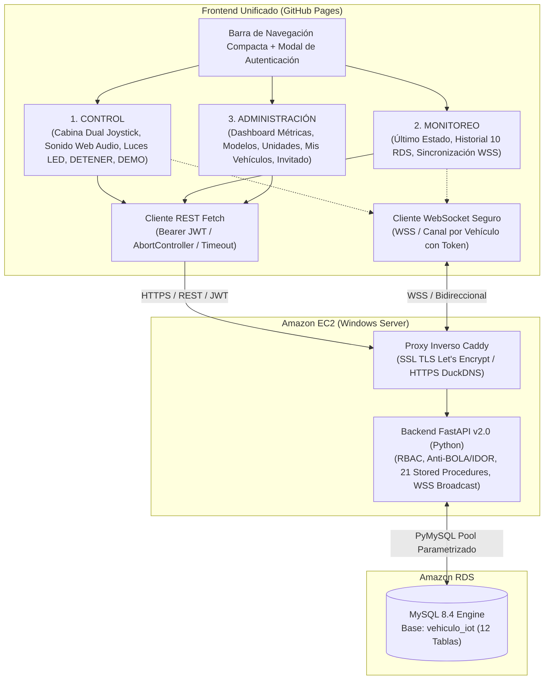

# Plataforma Web de Control, Monitoreo y Administración IoT · Excavadora (Mobile First)

Aplicación web integral, modular, reactiva y responsiva desarrollada como evolución de las prácticas 4.1 y 4.2, integrando la tercera aplicación de **ADMINISTRACIÓN COMERCIAL IoT (Práctica 4.3)**. El sistema se conecta a servicios REST y WebSocket seguros (WSS) desplegados en **Amazon EC2** y persistidos en **Amazon RDS for MySQL**.

* **Frontend Producción (GitHub Pages):** [https://ema1808.github.io/vehiculo-iot-control/](https://ema1808.github.io/vehiculo-iot-control/)
* **Backend API Swagger:** [https://vehiculo-iot-excavadora.duckdns.org/docs](https://vehiculo-iot-excavadora.duckdns.org/docs)
* **Desarrollado por:** Emanuel González Mayorga · 2026

---

## 1. Arquitectura del Sistema



---

## 2. Tres Vistas Integradas

### 1. Vista de CONTROL (Práctica 4.1)
* **Cabina Dual Joystick Táctil:**
  * **Joystick Izquierdo (Dirección):** Avanzar, Reversa, Giro Izquierda, Giro Derecha. Retorno elástico a neutral (`DETENER`).
  * **Joystick Derecho (Actuadores):** Subir Brazo, Bajar Brazo, Abrir Pala, Cerrar Pala. Retorno elástico a neutral.
  * **Soporte Multi-Touch Simultáneo:** Operación independiente con ambos pulgares en pantallas móviles.
* **Botones Auxiliares de Cabina:**
  * **🔊 Sonido de Excavadora:** Síntesis sonora en tiempo real de motor diésel mediante la *Web Audio API* nativa del navegador y emisión del comando `SONIDO`.
  * **💡 Luces LED Frontales:** Alternancia visual con halo dorado luminoso y emisión del comando `LUCES`.
* **Parada de Emergencia Prioritaria:** Botón rojo prominente `DETENER VEHÍCULO`.
* **Rutinas DEMO Autónomas:** Selector, inicio y cancelación en una sola fila compacta.
* **Diseño Zero-Scroll:** 100% visible en pantallas móviles sin necesidad de deslizar hacia abajo.

### 2. Vista de MONITOREO (Práctica 4.2)
* **Tarjeta de Último Movimiento / Estado:** Indicador en tiempo real del comando activo, código numérico, origen del evento y fecha/hora del servidor.
* **Tabla de los 10 Movimientos Persistidos:** Consulta semántica a Amazon RDS for MySQL (`sp_obtener_historial`) con diseño responsivo anti-desbordamiento.
* **Sincronización Reactiva:** Actualización instantánea ante eventos manuales o remotos mediante WebSocket seguro sin polling destructivo.

### 3. Vista de ADMINISTRACIÓN y RBAC (Práctica 4.3)
Adaptación dinámica de la interfaz según el rol del usuario autenticado:
* **Modo ADMINISTRADOR (`admin@iot.com`):**
  * Dashboard de métricas consolidadas (modelos, unidades totales, vendidas, exhibición, clientes, movimientos históricos).
  * Catálogo de modelos comerciales y microcontrolador base.
  * Inventario de unidades físicas con números de serie y estado comercial (`DISPONIBLE`, `VENDIDO`, `EXHIBICION`).
  * Asignación de vehículos a clientes y bitácora de auditoría.
* **Modo USUARIO / COMPRADOR (`comprador@iot.com`):**
  * Portal **Mis Vehículos** con tarjetas de unidades asignadas.
  * Conmutador para **Autorizar Soporte Técnico** al personal de la empresa.
  * Botón para cambiar de vehículo activo, adaptando el control y reconectando el canal WebSocket.
* **Modo INVITADO (`invitado@iot.com`):**
  * Catálogo comercial público con especificaciones técnicas.
  * Reserva temporal exclusiva de **3 minutos** en la unidad física de exhibición (`Excavadora Expo`), con temporizador de cuenta regresiva en vivo y detención automática al expirar.

---

## 3. Credenciales de Prueba por Rol

| Rol | Correo Electrónico | Contraseña | Alcance de Permisos |
| :--- | :--- | :--- | :--- |
| **ADMINISTRADOR** | `admin@iot.com` | `admin123` | Inventario, modelos, unidades, clientes, asignaciones y auditoría. *(No opera unidades vendidas sin soporte autorizado).* |
| **USUARIO** | `comprador@iot.com` | `comprador123` | Acceso exclusivo a sus unidades compradas, autorización de soporte, control y monitoreo privado. *(Protección Anti-BOLA/IDOR).* |
| **INVITADO** | `invitado@iot.com` | `invitado123` | Catálogo comercial público y prueba temporal de 3 minutos en unidad de exhibición. |

> El modal de inicio de sesión (`#modal-auth`) cuenta con 3 botones de acceso rápido para rellenar e iniciar sesión con un solo clic.

---

## 4. Estructura de Archivos del Frontend

```plaintext
vehiculo-iot-control/
├── .github/
│   └── workflows/
│       └── static.yml        # CI/CD de despliegue automático a GitHub Pages
├── .gitignore
├── .nojekyll                 # Bypass para Jekyll en GitHub Pages
├── favicon.svg               # Favicon vectorial oficial
├── index.html                # Estructura semántica con 3 vistas y modal de autenticación
├── README.md                 # Documentación técnica completa
├── css/
│   └── styles.css            # Estilos Mobile First, cabina dual joystick, brillo y tablas
└── js/
    ├── app.js                # Orquestador del ciclo de vida, joysticks, audio y eventos globales
    ├── config.js             # Configuración centralizada de endpoints y WebSocket
    ├── api/
    │   ├── apiClient.js      # Cliente Fetch con inyección automática de Bearer Token JWT
    │   └── vehicleService.js # Consumo de APIs REST (salud, comandos, estado, admin, portal)
    ├── components/
    │   ├── actionButtons.js  # Gestor de botones auxiliares
    │   ├── adminView.js      # Vista adaptativa de Administración por rol (Admin/User/Guest)
    │   ├── demoController.js # Controlador de secuencias DEMO autónomas
    │   ├── joystick.js       # Clase VirtualJoystick táctil multi-touch
    │   ├── monitoringView.js # Vista de Monitoreo (tarjeta y tabla de 10 registros)
    │   ├── navigation.js     # Gestor de pestañas accesibles (Control / Monitoreo / Admin)
    │   └── statusPanel.js    # Tira de conectividad (WSS, AWS API, RDS)
    ├── utils/
    │   └── dateFormatter.js  # Formateo de fecha y hora localizada
    └── ws/
        └── wsClient.js       # Cliente WebSocket seguro con reconexión y soporte de token
```

---

## 5. Indicadores de Conectividad Independientes

La aplicación cuenta con 3 indicadores independientes en el encabezado:
1. **Canal WSS (`#lbl-status-ws`):** Verifica el socket activo del navegador (`En línea`, `Reconectando`, `Desconectado`).
2. **Servidor AWS (`#lbl-status-api`):** Verifica la disponibilidad de la API REST en Amazon EC2 (`Disponible`, `Comprobando`, `No disponible`).
3. **Base RDS (`#lbl-status-rds`):** Diagnóstico reportado por el backend sobre la conexión a MySQL en Amazon RDS (`Disponible`, `No disponible`, `Sin verificar`).
